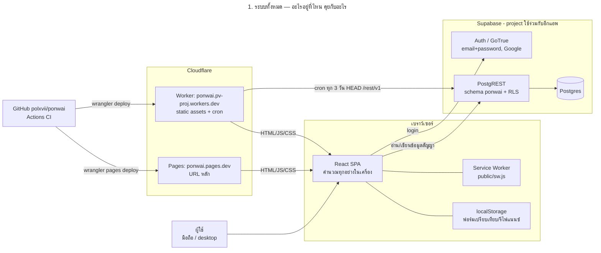
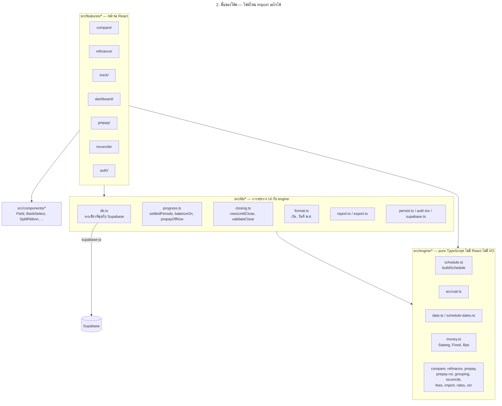
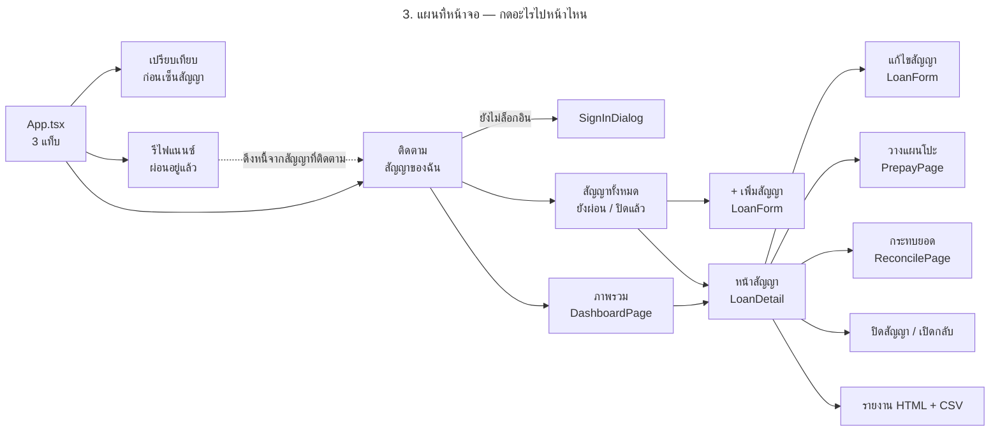
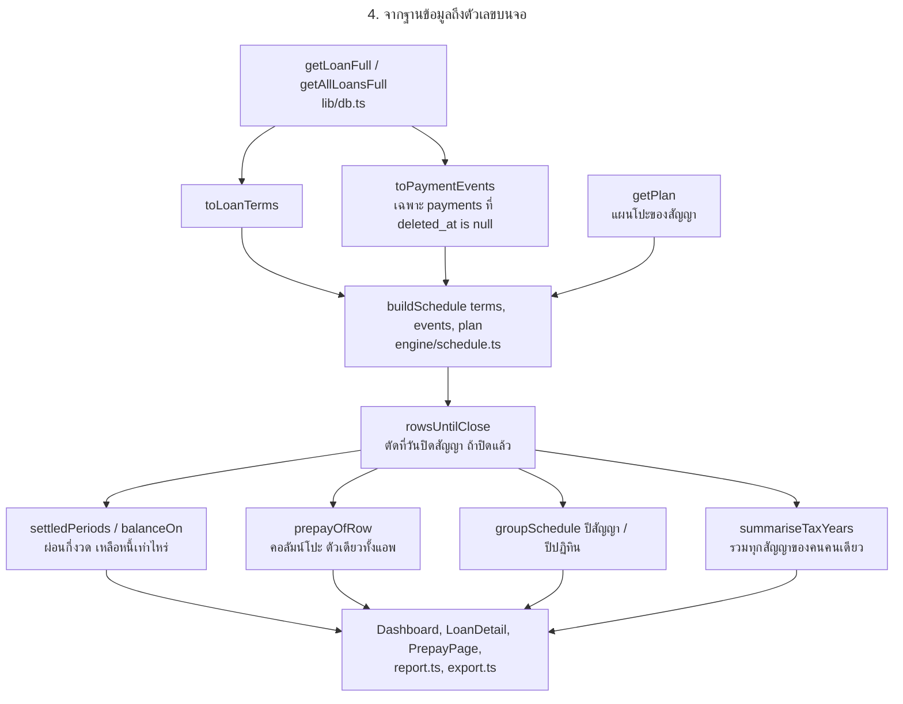
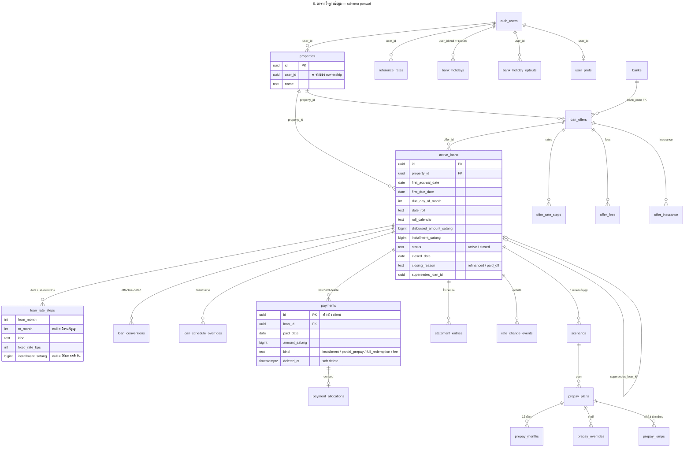
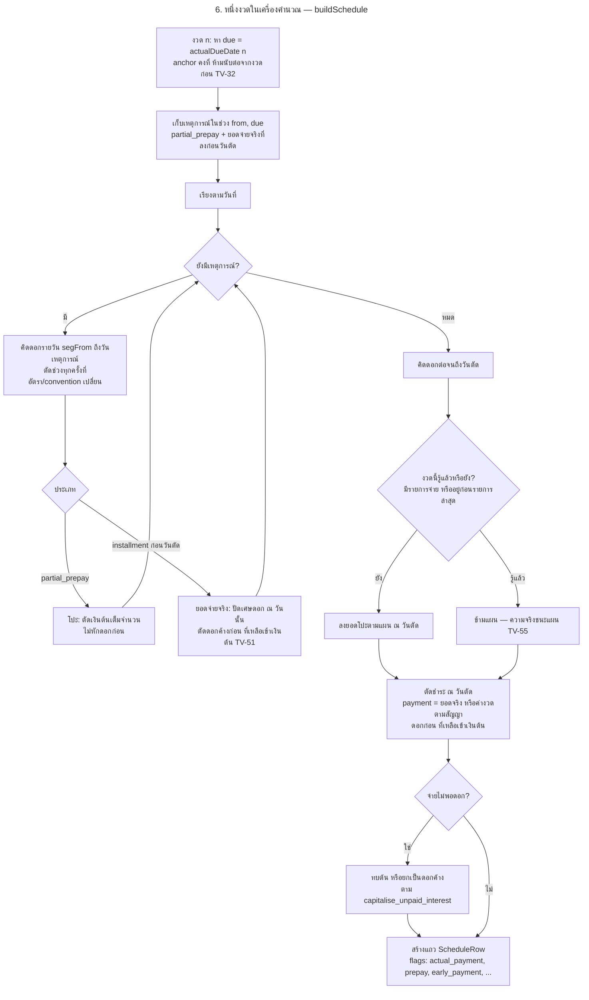
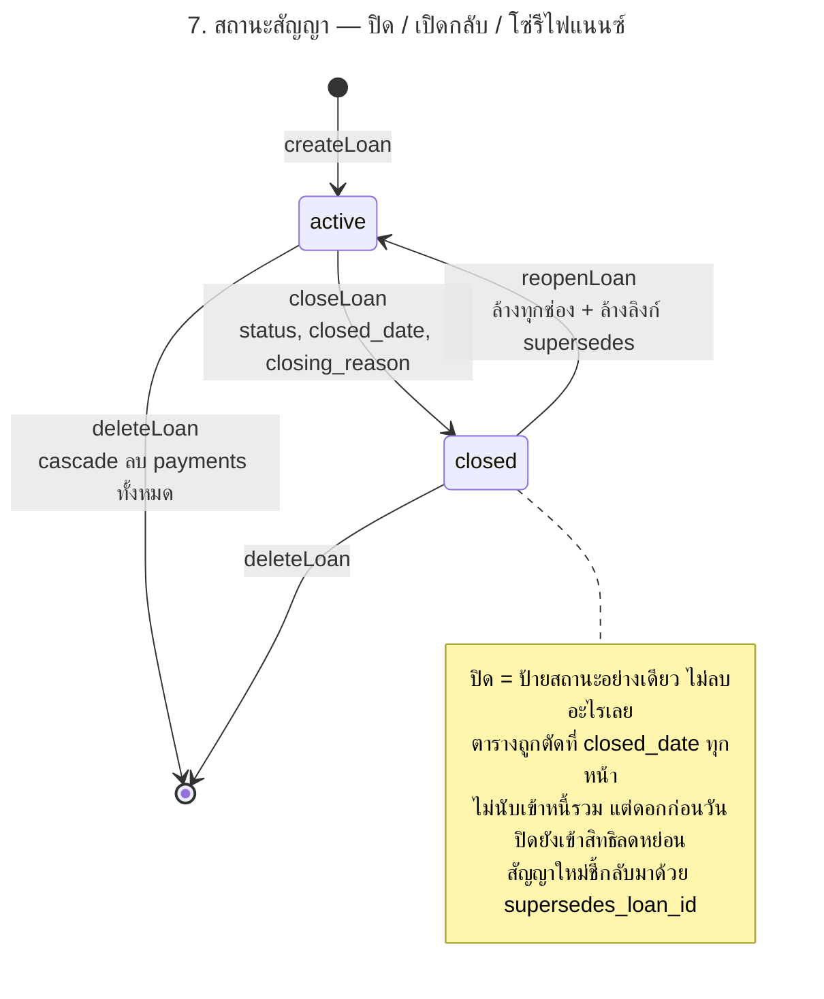
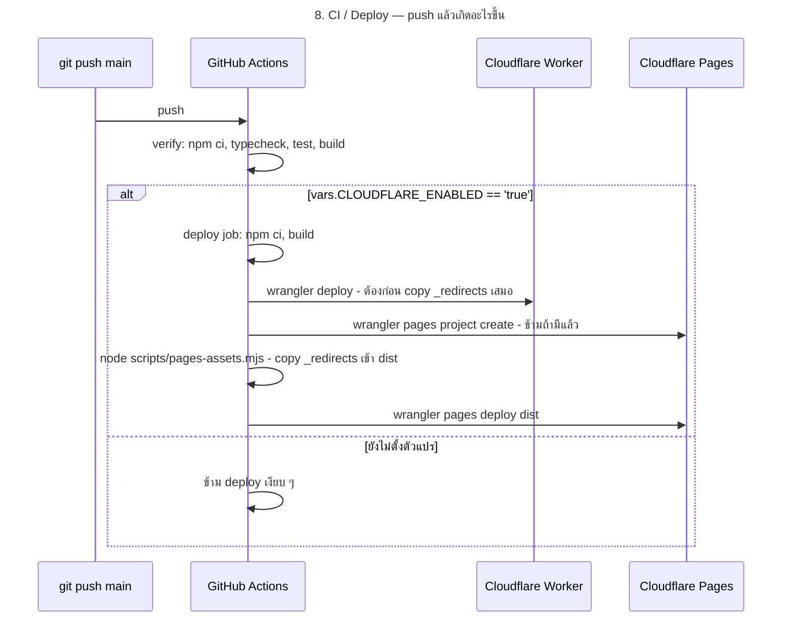
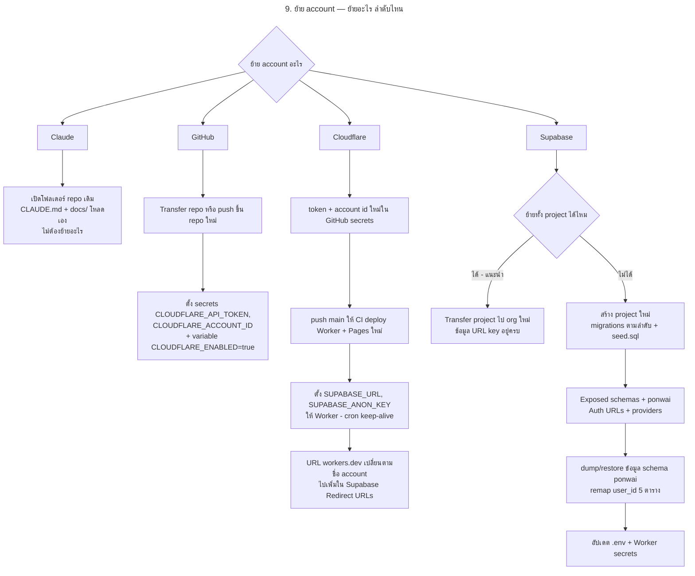

# Diagrams

ทุก diagram เขียนเป็น Mermaid — GitHub แสดงผลให้เอง และแก้เป็นข้อความได้เหมือนโค้ด
**ไฟล์นี้คือต้นฉบับ** · ภาพ SVG ใน [`diagrams/`](diagrams/README.md) สร้างจากไฟล์นี้ เปิดด้วยเบราว์เซอร์ไหนก็ได้
และถูกฝังอยู่ใน [project-summary.html](project-summary.html) ด้วย

⚠️ แก้ diagram ในไฟล์นี้แล้วต้องสร้างภาพใหม่ใน commit เดียวกัน — TV-56 ตรวจว่าภาพตรงกับต้นฉบับ ไม่ตรง CI แดง

```bash
node scripts/docs-diagrams.mjs
```

สคริปต์อ่าน `<!-- svg: ชื่อไฟล์ -->` ที่อยู่เหนือแต่ละ block เพื่อตั้งชื่อไฟล์ — **เพิ่ม diagram ใหม่ต้องใส่บรรทัดนี้ด้วย**
ต้องมี Chrome หรือ Edge ในเครื่อง (สคริปต์หาเอง) · ครั้งแรกจะดาวน์โหลด mermaid-cli ผ่าน npx

| # | Diagram | ไฟล์ภาพ |
|---|---|---|
| 1 | [ระบบทั้งหมด](#1-ระบบทั้งหมด) | [`01-system-overview.svg`](diagrams/01-system-overview.svg) |
| 2 | [ชั้นของโค้ด](#2-ชั้นของโค้ด) | [`02-code-layers.svg`](diagrams/02-code-layers.svg) |
| 3 | [แผนที่หน้าจอ](#3-แผนที่หน้าจอ) | [`03-screen-map.svg`](diagrams/03-screen-map.svg) |
| 4 | [จากฐานข้อมูลถึงตัวเลขบนจอ](#4-จากฐานข้อมูลถึงตัวเลขบนจอ) | [`04-data-flow-db-to-screen.svg`](diagrams/04-data-flow-db-to-screen.svg) |
| 5 | [ตารางในฐานข้อมูล](#5-ตารางในฐานข้อมูล) | [`05-database-tables.svg`](diagrams/05-database-tables.svg) |
| 6 | [หนึ่งงวดในเครื่องคำนวณ](#6-หนึ่งงวดในเครื่องคำนวณ) | [`06-engine-one-period.svg`](diagrams/06-engine-one-period.svg) |
| 7 | [สถานะสัญญา](#7-สถานะสัญญา) | [`07-loan-status.svg`](diagrams/07-loan-status.svg) |
| 8 | [CI / Deploy](#8-ci--deploy) | [`08-ci-deploy.svg`](diagrams/08-ci-deploy.svg) |
| 9 | [ย้าย account](#9-ย้าย-account) | [`09-account-migration.svg`](diagrams/09-account-migration.svg) |

---

## 1. ระบบทั้งหมด

<!-- svg: 01-system-overview -->


- หน้าเปรียบเทียบกับรีไฟแนนซ์ **ไม่ต้องล็อกอิน** คำนวณในเครื่องล้วน ใช้ออฟไลน์ได้
- หน้าติดตาม **ต้องล็อกอิน** ข้อมูลอยู่ใน Supabase กันด้วย RLS
- ⛔ Service worker ห้าม cache อะไรที่ไปหา Supabase (ข้อมูลการเงินส่วนตัว + ยอดเก่าเงียบ ๆ อันตราย)
- Worker อยู่ต่อเพราะ **Pages ไม่มี cron** — ถ้าไม่มีใครปลุก Supabase free tier จะ pause หลัง 7 วัน

---

## 2. ชั้นของโค้ด

<!-- svg: 02-code-layers -->


กฎ: ลูกศรชี้ลงอย่างเดียว — `engine/` ห้าม import จาก `lib/` หรือ `features/`
และห้ามใช้ `Date` ของ JS (วันที่เป็น civil date `'YYYY-MM-DD'` ล้วน)

---

## 3. แผนที่หน้าจอ

<!-- svg: 03-screen-map -->


---

## 4. จากฐานข้อมูลถึงตัวเลขบนจอ

<!-- svg: 04-data-flow-db-to-screen -->


⛔ ทุกหน้าต้องเดินเส้นนี้เส้นเดียวกัน — ใส่แผนโปะเหมือนกัน ตัดวันปิดเหมือนกัน
ไม่งั้นการ์ดกับตารางบนจอเดียวกันจะบอกวันปิดหนี้คนละวัน (เคยเกิดจริง)

---

## 5. ตารางในฐานข้อมูล

ตารางทั้งหมดอยู่ใน schema `ponwai` · ★ = แอพอ่าน/เขียนอยู่จริง · ไม่มีดาว = มีใน schema แต่แอพยังไม่ใช้

<!-- svg: 05-database-tables -->


---

## 6. หนึ่งงวดในเครื่องคำนวณ

`buildSchedule` ใน `src/engine/schedule.ts` — วนทีละงวด แต่ละงวดทำแบบนี้

<!-- svg: 06-engine-one-period -->


---

## 7. สถานะสัญญา

<!-- svg: 07-loan-status -->


---

## 8. CI / Deploy

<!-- svg: 08-ci-deploy -->


⛔ ห้ามย้าย `deploy/pages/_redirects` ไปไว้ใน `public/` — wrangler อ่าน `dist/_redirects`
เป็น metadata ของ Worker แล้ว `wrangler deploy` ตาย (CI เคยแดง 3 commit, ab94543 → 2cefb8d)

---

## 9. ย้าย account

รายละเอียดทีละขั้นอยู่ที่ [account-migration.md](account-migration.md)

<!-- svg: 09-account-migration -->

